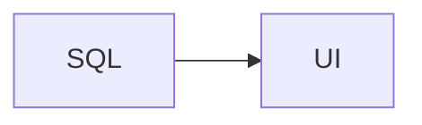

# SQLFormys

SQLFormys is a tool that turns SQL queries into dynamic data entry forms (like INSERT/UPDATE). The goal is to make it easy to input data into your database tables through a simple web interface, without having to build custom CRUD pages from scratch.

## Key Features

- **Dynamic Form Generation:** Maps SQL data types (like INT, VARCHAR, DATE) to the appropriate HTML input types automatically.
- **Data Export:** Download query results easily in CSV or Excel formats.
- **Interactive Grid:** Filter and search through query results dynamically right from the UI.
- **Favorites Menu:** Save your most-used modules or tables to a quick-access favorites section.
- **Smart Parsing:** Automatically reads metadata like table structures, description tags, primary/foreign keys, and execution modes from your SQL comments.
- **Database Compatibility:** Supports standard relational databases such as PostgreSQL, MySQL, SQLite, and SQL Server.
- **Secure by Default:** Utilizes parameterized queries to protect your database from SQL injection.

## Tech Stack

- **Backend:** Go (using the standard library HTTP router)
- **Frontend:** Vanilla HTML, CSS, and JavaScript (served via Nginx)

## Getting Started

You can run the complete project using Docker or by starting the services manually.

### 1. Using Docker Compose

If you have Docker installed, simply run the following command in the root directory:

```bash
docker compose up --build
```

This will spin up the PostgreSQL database, the Go API, and the static frontend automatically.

### 2. Manual Setup

If you prefer to run the services individually on your local machine:

**Backend:**
Go to the `back` folder, copy `.env.example` to a new `.env` file, configure your settings, and start the server:

```bash
cd back
go run cmd/api/main.go
```

**Frontend:**
The frontend consists of static files. To run it locally:
1. In the `front` folder, copy `config.js.template` to a new file named `config.js`.
2. Configure the API URL (by default, `http://localhost:8080/api`).
3. Open `index.html` in your browser, or use a local static server (like the VS Code Live Server extension).

### Custom frontend title

The default branding in the browser tab and top header is **SQLFormys**. To show a custom product or environment name next to it (for example your company or `Homologation`), set **`PRODUCT_NAME`** in the project `.env` file (see `.env.example` under the API section).

```env
PRODUCT_NAME=Acme Logistics
```

Restart the Go API after changing `.env`. When the page loads, the frontend calls `GET /api/projects`; if `productName` is returned, it updates:

- The **browser tab title** to `SQLFormys (Acme Logistics)`
- The **header logo text** to the same string

If `PRODUCT_NAME` is empty or unset, the UI keeps the defaults from `front/index.html` (`SQLFormys` only).

### Application version

The version shown in the sidebar footer comes from the API (`GET /api/version`). To release a new version, edit the single line in [`back/internal/version/VERSION`](back/internal/version/VERSION) and rebuild or restart the API (`go run` / Docker image build embeds that file into the binary).

### API access log (file rotation)

Each HTTP request is written to rotating log files (see the **Log da API** section in [`.env.example`](.env.example)). Defaults: `back/logs/api.log`, rotation by size (`LOG_ROTATION=size`), or by calendar day (`daily` / `date`).

Example line:

```text
2026-03-23 14:30:00 | ip=127.0.0.1 | user=EMPRESA\regivaldo | GET | path=/api/projects query=foo=bar | status=200 | duration_ms=27
```

For `POST`/`PUT`/`PATCH`, the request body is truncated according to `LOG_REQUEST_BODY_MAX_BYTES` (use `0` to disable). Application errors already emitted with `log.Printf` in handlers also go to the same file when `LOG_ENABLED=true`.

With Docker Compose, `./back/logs` is mounted on `/app/logs` inside the API container.

**Note:** This setting is for application branding. The title above each module form comes from the module name in the sidebar (the `.sql` filename); the subtitle path and the optional `--DESCRIPTION=` header tag control other on-screen text for that module.

When running the API manually from the `back` folder, ensure the process can read your `.env` (the backend loads `.env` from the current working directory). With Docker Compose, variables from the root `.env` are passed to the API service when it is enabled.

### Optional network authentication (IIS-style / Negotiate)

Authentication is **off by default**. Set `AUTH_ENABLED=true` in the project `.env` to require a domain network identity on every `/api/*` call. There is **no password form** on the frontend: the browser performs a **Negotiate (Kerberos)** handshake, similar to IIS Windows Authentication.

| Variable | Role |
| :--- | :--- |
| `AUTH_ENABLED` | `false` (default) = open app; `true` = protect API |
| `AUTH_DEV_USER` | Only with `APP_ENV=development`: simulates `DOMAIN\user` on Linux without Active Directory |
| `AUTH_KRB_KEYTAB` | Production: path to the HTTP service keytab |
| `AUTH_KRB_SPN` | Production: service principal name (e.g. `HTTP/sqlformys.company.local`) |

When authentication is enabled, serve the UI through **Nginx** with `API_BASE_URL=/api` so static files and the API share the same origin. Cross-origin calls (`http://localhost:3000` → `http://localhost:8080`) break Negotiate. The frontend Dockerfile includes [`front/nginx.conf`](front/nginx.conf) proxying `/api/` to the Go container.

**Development (auth on, no AD):**

```env
APP_ENV=development
AUTH_ENABLED=true
AUTH_DEV_USER=COMPANY\your.user
```

**Production:**

```env
AUTH_ENABLED=true
AUTH_KRB_KEYTAB=/path/to/http.keytab
AUTH_KRB_SPN=HTTP/sqlformys.company.local
API_BASE_URL=/api
```

The header shows the connected user after `GET /api/auth/me`. Browsers must treat the site as **intranet/trusted** for automatic Negotiate. If identity cannot be obtained, the UI shows “Não autenticado na rede” and does not load modules (no credential prompt).

Set `AUTH_ENABLED=false` in `front/config.js` (or via Docker `envsubst`) when running the static UI against a separate API URL during local development without auth.

### Deploy em Linux/Docker sem Active Directory (HTTP Basic no Nginx)

When front and API run in containers on a Linux server **without** Kerberos/AD, use **Nginx HTTP Basic Auth** on the `front` container instead of `AUTH_KRB_*`. You manage users yourself; no infrastructure team is required for AD/SPN/keytab.

| Variable | Role |
| :--- | :--- |
| `AUTH_ENABLED` | Keep **`false`** (API stays open behind the proxy; login is at Nginx) |
| `API_BASE_URL` | Use **`/api`** so the UI and API share the same origin through Nginx |
| `NGINX_BASIC_AUTH_ENABLED` | `true` to prompt for username/password in the browser |
| `NGINX_BASIC_AUTH_REALM` | Text shown in the browser login dialog |
| `NGINX_BASIC_AUTH_HTPASSWD_HOST_PATH` | Path on the **host** to the `htpasswd` file (default `./front/secrets/htpasswd`) |
| `NGINX_BASIC_AUTH_HTPASSWD_FILE` | Path **inside** the `front` container (default `/etc/nginx/secrets/htpasswd`) |
| `HTPASSWD_PATH` | Path **inside the API container** to the same htpasswd file (read/write for password changes and user admin) |
| `ADMINISTRATORS` | Comma-separated usernames seeded as admins on first run |
| `ADMINISTRATORS_FILE` | Host file listing current admins (default: `administrators` next to htpasswd) |

**1. Create credentials** (on the host):

```bash
mkdir -p front/secrets
htpasswd -bc front/secrets/htpasswd your.username
```

Or outside the repo, e.g. `/var/lib/sqlformys/htpasswd`, and set `NGINX_BASIC_AUTH_HTPASSWD_HOST_PATH` in `.env`.

(`apache2-utils` on Debian/Ubuntu; see [`front/secrets/README.md`](front/secrets/README.md).)

**2. Configure `.env`:**

```env
AUTH_ENABLED=false
API_BASE_URL=/api
NGINX_BASIC_AUTH_ENABLED=true
NGINX_BASIC_AUTH_REALM=SQLFormys
# NGINX_BASIC_AUTH_HTPASSWD_HOST_PATH=/var/lib/sqlformys/htpasswd
```

**3. Start with Docker Compose.** The `front` service bind-mounts the host `htpasswd` file read-only; the `api` service mounts the **same** file read/write for in-app password changes and administrator user management. Create an empty administrators file on the host if needed, e.g. `touch ./administrators && chmod 600 ./administrators`, and set `ADMINISTRATORS_HOST_PATH` in `.env` when using a custom path.

**Add users later:** administrators can use **Usuários** in the sidebar UI, or run `htpasswd -b <host-path> newuser` on the server. Nginx re-reads the file per request — no container restart required.

**In the UI:** logged-in users see a profile badge beside the theme toggle (user icon vs shield for administrators). Everyone with Basic Auth configured can **Trocar senha** from that menu (current password required; strong password rules enforced). Administrators additionally manage users, edit `.sql` modules (CodeMirror), and create or rename folders under `back/queries`.

Do **not** enable Kerberos (`AUTH_ENABLED=true`) and Basic Auth at the same time: both use the `Authorization` header and will conflict.

For defense in depth, you can still restrict network access (VPN, firewall) in addition to Basic Auth.

## Writing query modules

Each `.sql` file under `back/queries/<project>/` becomes a module in the UI. The filename (without `.sql`) is the module name; the parent folder is the project.

The engine reads **comment tags** in the file: header metadata, a `--<PROPERTIES>` block that describes form fields, and optional inline conditionals in the SQL itself.

### Header tags

Place these at the top of the file (outside the properties block):

| Tag | Purpose |
|---|---|
| `--SERVER=...` | Database host/connection. If omitted, the API default is used. |
| `--DESCRIPTION=...` | Short text shown for the module in the UI. |
| `--EXECUTE_MODE=AUTO` | Run as soon as the form is submitted (no extra confirmation). |
| `--RESULT_TYPE=...` | How query results are rendered in the UI (see values below). Defaults to **GRID** if missing or invalid. |
| `--TIMEOUT=10` | Query timeout in seconds. Defaults to **60** if missing or invalid. |
| `--<PROPERTIES>` / `--</PROPERTIES>` | Block that defines the form fields. |

**`--RESULT_TYPE` values** (case-insensitive):

| Value | Behavior |
| :--- | :--- |
| `GRID` | Default tabular grid (filter, sort, CSV/Excel export). |
| `TEXT` | Plain text (`<pre>`). |
| `HTML` | Full HTML document inside a sandboxed iframe. |
| `MARKDOWN` | Markdown rendered as HTML (sanitized). |
| `MERMAID` | Entire result treated as one Mermaid diagram. |
| `DOCUMENT` | Markdown plus embedded ` ```mermaid ` fenced blocks (Markdown + Mermaid in one view). |

For types other than `GRID`, the UI concatenates the **first column** of every result row with line breaks into a single document (typical pattern: `SELECT '# Title' AS body` or one HTML/Markdown string per row).

Minimal module with **Markdown and a Mermaid diagram** (`DOCUMENT`). No `--<PROPERTIES>` block is required; `AUTO` runs the query as soon as you open the module. Put the full document in the first result column (here `body`):

````sql
--DESCRIPTION=Relatório visual
--RESULT_TYPE=DOCUMENT
--EXECUTE_MODE=AUTO

SELECT $doc$
# Resumo


$doc$ AS body;
````

On PostgreSQL, dollar-quoting (`$doc$ … $doc$`) keeps backticks and newlines inside the string. On SQL Server, build the same text with `N'…'`, `CHAR(10)`, and concatenation (`+`) instead of `$doc$`.

```sql
--SERVER=localhost
--DESCRIPTION=Search files by name
--EXECUTE_MODE=AUTO
--RESULT_TYPE=GRID
--TIMEOUT=30
```

### Properties block

Every field the user should fill in goes between `--<PROPERTIES>` and `--</PROPERTIES>`. Only commented lines that contain `?` are parsed.

Basic shape:

```text
-- PREFIX @?#FIELD_NAME:TYPE:SIZE:OPERATOR:Label:default:help
```

| Segment | Meaning |
|---|---|
| Prefix | SQL fragment reused on injection (`SELECT`, `AND`, `WHERE`, …). On PostgreSQL the block is removed and values are exposed as session vars (`current_setting('vars.FIELD_NAME')`). |
| `@` | Treat as a variable assignment (`SELECT @NAME = value` on SQL Server). Without `@`, the line is injected as a filter (`AND COLUMN = value`). |
| `?` | Ask the user (required for the line to become a form control). |
| `#` | Required field. Omit `#` to make it optional. |
| `FIELD_NAME` | Variable / column name. |
| `TYPE` | Controls which HTML input is rendered (see below). |
| `SIZE` | Display size / `maxLength` for text. |
| `OPERATOR` | Comparison used on injection (`=`, `LIKE`, …). |
| `Label` | Text shown next to the control. |
| `default` | Optional default value. |
| `help` | Optional tooltip (info icon). |

```sql
--<PROPERTIES>
-- SELECT @?NM_ARQUIVO:VARCHAR:100:=:File name
-- SELECT @?#IC_TAMANHO:CHAR:1:=:Show size column?:S:Include the size column in the result
--</PROPERTIES>
```

### Field types (controls)

| Type | Control | Example |
|---|---|---|
| `VARCHAR` / `TEXT` / anything else | Text input (`maxLength` = size) | `@?NM_ARQUIVO:VARCHAR:100:=:File name` |
| `CHAR` with size `1` | Yes (`S`) / No (`N`) radios | `@?#IC_TAMANHO:CHAR:1:=:Show size?:S:Help text` |
| `INT` / `INTEGER` / `NUMERIC` / `DECIMAL` / `FLOAT` | Number input | `@?CD_REMETENTE:INT:8:=:Sender` |
| `DATE` / `DATETIME` / `TIMESTAMP` | Date picker | `@?#DT_INICIAL:DATE:8:=:Start date` |
| `SINGLE(value=label,...)` | Single-select dropdown | `@?IC_TIPO:SINGLE(S=Simple,V=Several):VARCHAR:10:=:Type:N` |
| `MULTI(...)` or `MULTIPLE(...)` | Multi-select dropdown | `@?#SG_UF:MULTI(SP=São Paulo,RJ=Rio de Janeiro):VARCHAR:80:=:States:SP,RJ` |
| `LOOKUP(Name)` | Single-select filled by a named query in the same `.sql` file | `@?CD_USUARIO:LOOKUP(NomeDoLookUp):VARCHAR:10:=:User` |
| `LOOKUP_MULTI(Name)` | Multi-select filled by a named query | `@?#SG_UF:LOOKUP_MULTI(UFsAtendimento):VARCHAR:80:=:States` |
| `CONTEXT(Key)` | Hidden field filled from the authenticated session (not shown in the form) | `@?NM_USUARIO:CONTEXT(USER_NAME):VARCHAR:50:=:` |

`SINGLE` / `MULTI` / `LOOKUP` / `LOOKUP_MULTI` / `CONTEXT` need an extra SQL type after the parentheses (`VARCHAR`, `INT`, …). That is the type sent to the database.

**Context keys:** The API overwrites any client-supplied value for these fields on execute and lookup.

| Key | Value |
|---|---|
| `USER_NAME` | Logged-in username (login) |
| `USER_TYPE` | `Administrator` if the user is an admin, otherwise `Standard` |

Option and multi-default separators: `,` `;` or `|`.

```sql
-- SELECT @?IC_TIPO:SINGLE(S=Simple,V=Several,A=Some,Nenhum):VARCHAR:10:=:Type:N:Pick one value
-- SELECT @?#SG_UF:MULTI(AC=Acre,AL=Alagoas,SP=São Paulo,RJ=Rio de Janeiro,MG=Minas Gerais):VARCHAR:80:=:States:SP,RJ:Select one or more UFs
```

There is no dedicated `TEXTAREA`, `TIME`, or `BOOLEAN` type. Anything that is not `CHAR:1`, a date, a number, `SINGLE`, `MULTI`, or `LOOKUP` is rendered as a text box.

### Lookup queries (dynamic dropdowns)

Use `LOOKUP` when the options should come from the database instead of a static list. Define a named query in the same `.sql` file (outside `--<PROPERTIES>`):

```sql
--<LOOKUP NomeDoLookUp>
SELECT CdUsuario AS Code, NmUsuario AS Value
FROM COR_USUARIO
WHERE CdEmpresa = @CD_EMPRESA
--</LOOKUP>
```

Then point a field at that name:

```sql
-- SELECT @?CD_USUARIO:LOOKUP(NomeDoLookUp):VARCHAR:10:=:User::Pick a user
```

Opening the dropdown in the UI runs `POST /api/lookups/{module}?name=NomeDoLookUp` with the current form values. The lookup SQL receives the same variables as the main query (`SELECT @CD_EMPRESA=...` on SQL Server, `current_setting('vars.CD_EMPRESA')` on PostgreSQL) and also supports `/*[VAR=VAL]*/.../*[/VAR]*/` fragments. After options load, the dropdown includes a **search box** that filters the list locally by code or label.

The lookup result should expose **Code** (option value) and **Value** (option label). If those aliases are missing, the first two columns are used. Lookup blocks are stripped before the main module query runs.

### Operators

The fourth segment is the SQL operator. Common values:

- `=` — equality / variable assignment
- `LIKE` — on SQL Server the value is wrapped as `'%...%'`

Numeric types (`INT`, `DECIMAL`, `NUMERIC`, `FLOAT`) are injected unquoted; everything else is quoted.

```sql
-- AND ?A.NM_CLIENTE:VARCHAR:50:LIKE:Customer name
-- AND ?#A.CD_MARKETPLACE:INT:4:=:Marketplace code
```

### Conditional fragments in the query

You can include or drop pieces of SQL based on a field value:

```sql
/*[IC_TAMANHO=S]*/NR_TAMANHO_BYTES as "Size",/*[/IC_TAMANHO]*/
```

If `IC_TAMANHO` equals `S`, the inner fragment stays; otherwise it is removed. Use this to toggle columns, joins, or parts of `WHERE`.

### Complete example (PostgreSQL)

```sql
--SERVER=localhost
--DESCRIPTION=Search files by name
--EXECUTE_MODE=AUTO

--<PROPERTIES>
-- SELECT @?NM_ARQUIVO:VARCHAR:100:=:File name
-- SELECT @?#IC_TAMANHO:CHAR:1:=:Show size column?:S:The size column is returned only when Yes is selected
-- SELECT @?#SG_UF:MULTI(SP=São Paulo,RJ=Rio de Janeiro,MG=Minas Gerais):VARCHAR:80:=:States:SP,RJ:Select one or more UFs
--</PROPERTIES>

SELECT
    CD_ARQUIVO as "Id",
    NM_ARQUIVO as "Description",
    /*[IC_TAMANHO=S]*/NR_TAMANHO_BYTES as "Size",/*[/IC_TAMANHO]*/
    DH_REGISTRO as "Date"
FROM dbo.COR_ARQUIVO
WHERE (
    current_setting('vars.NM_ARQUIVO', true) IS NULL
    OR current_setting('vars.NM_ARQUIVO', true) = ''
    OR NM_ARQUIVO LIKE '%' || current_setting('vars.NM_ARQUIVO', true) || '%'
)
AND (
    current_setting('vars.SG_UF', true) IS NULL
    OR current_setting('vars.SG_UF', true) = ''
    OR SG_UF = ANY(string_to_array(current_setting('vars.SG_UF', true), ','))
);
```

On PostgreSQL the properties block is stripped and values are set as session variables before the query runs.

### Complete example (SQL Server)

On SQL Server the same `--<PROPERTIES>` block is **replaced** with assignment statements (`SELECT @NM_ARQUIVO='...'`). Declare the variables first; the query then reads those `@` variables.

```sql
--SERVER=localhost
--DESCRIPTION=Search files by name
--EXECUTE_MODE=AUTO

DECLARE @NM_ARQUIVO VARCHAR(100),
        @IC_TAMANHO CHAR(1),
        @SG_UF      VARCHAR(80)

--<PROPERTIES>
-- SELECT @?NM_ARQUIVO:VARCHAR:100:=:File name
-- SELECT @?#IC_TAMANHO:CHAR:1:=:Show size column?:S:The size column is returned only when Yes is selected
-- SELECT @?#SG_UF:MULTI(SP=São Paulo,RJ=Rio de Janeiro,MG=Minas Gerais):VARCHAR:80:=:States:SP,RJ:Select one or more UFs
--</PROPERTIES>

SELECT
    CD_ARQUIVO as [Id],
    NM_ARQUIVO as [Description],
    /*[IC_TAMANHO=S]*/NR_TAMANHO_BYTES as [Size],/*[/IC_TAMANHO]*/
    DH_REGISTRO as [Date]
FROM dbo.COR_ARQUIVO
WHERE (
    @NM_ARQUIVO IS NULL
    OR @NM_ARQUIVO = ''
    OR NM_ARQUIVO LIKE '%' + @NM_ARQUIVO + '%'
)
AND (
    @SG_UF IS NULL
    OR @SG_UF = ''
    OR SG_UF IN (SELECT LTRIM(RTRIM([value])) FROM STRING_SPLIT(@SG_UF, ','))
)
```

After a POST with `NM_ARQUIVO=valotes`, `IC_TAMANHO=S` and `SG_UF=SP,RJ`, the properties block becomes:

```sql
SELECT @NM_ARQUIVO='valotes'
SELECT @IC_TAMANHO='S'
SELECT @SG_UF='SP,RJ'
```

You can also put filters **inside** the properties block (no `@`). Those lines are injected as `AND` / `WHERE` predicates, and `LIKE` wraps the value with `%...%`:

```sql
--<PROPERTIES>
-- AND ?#A.CD_MARKETPLACE:INT:4:=:Marketplace code
-- AND ?A.NM_CLIENTE:VARCHAR:50:LIKE:Customer name
--</PROPERTIES>
```

On **GET** `/query/<project>/<module>` the API returns the parsed fields as JSON so the frontend can render the form. On **POST** the submitted values are injected and the query is executed.

## Why SQLFormys?

Building repetitive CRUD interfaces for database tables takes a lot of time. SQLFormys connects raw SQL queries directly to functional web forms to bridge the gap between databases and users, making data input fast and straightforward.


