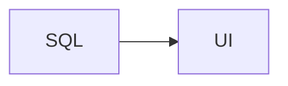

# SQL modules

The SQL engine reads **comment tags** in the file: header metadata, a `--<PROPERTIES>` block that describes form fields, optional named queries and LOOKUP blocks, and optional inline conditionals in the SQL itself.

For wizards, `{{FIELD}}` text, and `STEP`/`WIZARD`, see [Wizard](wizard.md).

## Header tags

Place these at the top of the file (outside the properties block):

| Tag | Purpose |
|---|---|
| `--SERVER=...` | Database host/connection. If omitted, the API default is used. |
| `--DESCRIPTION=...` | Short text shown for the module in the UI. |
| `--EXECUTE_MODE=AUTO` | Run as soon as the form is submitted (no extra confirmation). Ignored when `--CONFIRM` is present (user must click **Executar** and confirm). |
| `--CONFIRM` | Before **Executar**, show a confirmation modal (type **CONFIRM**, default message). Same as `--CONFIRM=CONFIRM`. |
| `--CONFIRM=CONFIRM` | Same as bare `--CONFIRM`. |
| `--CONFIRM=WARNING: …` | Confirmation modal styled as a warning, with the text after the colon as the body (supports `{{FIELD}}` interpolation). |
| `--CONFIRM=DANGER: …` | Destructive confirmation modal; primary action is **Executar mesmo assim**. |
| `--MESSAGE=WARNING: …` | User message modal (same look as CONFIRM) when the module opens. You may use several lines. Types: **CONFIRM**, **WARNING**, **DANGER**. Supports `{{FIELD}}`. Does not block **Executar** (unlike `--CONFIRM`). |
| `--RESULT_TYPE=...` | How query results are rendered in the UI (see [modules overview](modules.md#result_type-all-kinds)). Defaults to **GRID** if missing or invalid. |
| `--TIMEOUT=10` | Query timeout in seconds. Defaults to **60** if missing or invalid. |
| `--CACHE=15s` | Cache **module execution** (`POST /api/queries/...`, wizard steps, named `QUERY`) for the given duration. Suffix `s` (seconds), `m` (minutes), or `h` (hours); max **24h**. Does **not** apply to LOOKUP dropdowns. |
| `--INCLUDE=...` | Inlines another module from a **Library** folder (same `kind` as the host). Path is logical (no extension), relative to `back/queries`. |
| `--<PROPERTIES>` / `--</PROPERTIES>` | Block that defines the form fields. |

### DOCUMENT example

Minimal module with **Markdown and a Mermaid diagram** (`DOCUMENT`). No `--<PROPERTIES>` block is required; `AUTO` runs the query as soon as you open the module. Put the full document in the first result column (here `body`):

````sql
--DESCRIPTION=Relatório visual
--RESULT_TYPE=DOCUMENT
--EXECUTE_MODE=AUTO

SELECT $doc$
# Resumo


$doc$ AS body;
````

On PostgreSQL, dollar-quoting (`$doc$ … $doc$`) keeps backticks and newlines inside the string. On SQL Server, build the same text with `N'…'`, `CHAR(10)`, and concatenation (`+`) instead of `$doc$`.

```sql
--SERVER=localhost
--DESCRIPTION=Search files by name
--EXECUTE_MODE=AUTO
--RESULT_TYPE=GRID
--TIMEOUT=30
```

## Properties block

Every field the user should fill in goes between `--<PROPERTIES>` and `--</PROPERTIES>`. Only commented lines that contain `?` are parsed.

Basic shape:

```text
-- PREFIX @?#FIELD_NAME:TYPE:SIZE:OPERATOR:Label:default:help
```

| Segment | Meaning |
|---|---|
| Prefix | SQL fragment reused on injection (`SELECT`, `AND`, `WHERE`, …). On PostgreSQL the block is removed and values are exposed as session vars (`current_setting('vars.FIELD_NAME')`). |
| `@` | Treat as a variable assignment (`SELECT @NAME = value` on SQL Server). Without `@`, the line is injected as a filter (`AND COLUMN = value`). |
| `?` | Ask the user (required for the line to become a form control). |
| `#` | Required field. Omit `#` to make it optional. |
| `FIELD_NAME` | Variable / column name. |
| `TYPE` | Controls which HTML input is rendered (see below). |
| `SIZE` | Display size / `maxLength` for text. |
| `OPERATOR` | Comparison used on injection (`=`, `LIKE`, …). |
| `Label` | Text shown next to the control. |
| `default` | Optional default value. |
| `help` | Optional tooltip (info icon). |

```sql
--<PROPERTIES>
-- SELECT @?NM_ARQUIVO:VARCHAR:100:=:File name
-- SELECT @?#IC_TAMANHO:CHAR:1:=:Show size column?:S:Include the size column in the result
--</PROPERTIES>
```

## Field types (controls)

| Type | Control | Example |
|---|---|---|
| `VARCHAR` / `TEXT` / anything else | Text input (`maxLength` = size) | `@?NM_ARQUIVO:VARCHAR:100:=:File name` |
| `CHAR` with size `1` | Yes (`S`) / No (`N`) radios | `@?#IC_TAMANHO:CHAR:1:=:Show size?:S:Help text` |
| `INT` / `INTEGER` / `NUMERIC` / `DECIMAL` / `FLOAT` | Number input | `@?CD_REMETENTE:INT:8:=:Sender` |
| `DATE` / `DATETIME` / `TIMESTAMP` | Date picker | `@?#DT_INICIAL:DATE:8:=:Start date` |
| `SINGLE(value=label,...)` | Single-select dropdown | `@?IC_TIPO:SINGLE(S=Simple,V=Several):VARCHAR:10:=:Type:N` |
| `MULTI(...)` or `MULTIPLE(...)` | Multi-select dropdown | `@?#SG_UF:MULTI(SP=São Paulo,RJ=Rio de Janeiro):VARCHAR:80:=:States:SP,RJ` |
| `LOOKUP(Name)` | Single-select filled by a named query in the same `.sql` file | `@?CD_USUARIO:LOOKUP(NomeDoLookUp):VARCHAR:10:=:User` |
| `LOOKUP_MULTI(Name)` | Multi-select filled by a named query | `@?#SG_UF:LOOKUP_MULTI(UFsAtendimento):VARCHAR:80:=:States` |
| `CONTEXT(Key)` | Hidden field filled from the authenticated session (not shown in the form) | `@?NM_USUARIO:CONTEXT(USER_NAME):VARCHAR:50:=:` |

`SINGLE` / `MULTI` / `LOOKUP` / `LOOKUP_MULTI` / `CONTEXT` need an extra SQL type after the parentheses (`VARCHAR`, `INT`, …). That is the type sent to the database.

**Context keys:** The API overwrites any client-supplied value for these fields on execute and lookup.

| Key | Value |
|---|---|
| `USER_NAME` | Logged-in username (login) |
| `USER_TYPE` | `Administrator` if the user is an admin, otherwise `Standard` |

Option and multi-default separators: `,` `;` or `|`.

```sql
-- SELECT @?IC_TIPO:SINGLE(S=Simple,V=Several,A=Some,Nenhum):VARCHAR:10:=:Type:N:Pick one value
-- SELECT @?#SG_UF:MULTI(AC=Acre,AL=Alagoas,SP=São Paulo,RJ=Rio de Janeiro,MG=Minas Gerais):VARCHAR:80:=:States:SP,RJ:Select one or more UFs
```

There is no dedicated `TEXTAREA`, `TIME`, or `BOOLEAN` type. Anything that is not `CHAR:1`, a date, a number, `SINGLE`, `MULTI`, or `LOOKUP` is rendered as a text box.

## Lookup queries (dynamic dropdowns)

Define a named query in the same `.sql` file (outside `--<PROPERTIES>`):

```sql
--<LOOKUP NomeDoLookUp 2m>
SELECT CdUsuario AS Code, NmUsuario AS Value
FROM COR_USUARIO
WHERE CdEmpresa = @CD_EMPRESA
--</LOOKUP>
```

Optional cache on the block: append `2m` or `CACHE=2m` on the opening tag (same `s`/`m`/`h` format as `--CACHE`). Without it, the lookup is not cached at block level.

Per-field cache (wins over the block):

```sql
-- SELECT @?CD_USUARIO:LOOKUP(NomeDoLookUp, 30s):VARCHAR:10:=:User::Pick a user
-- SELECT @?CD_USUARIO:LOOKUP(NomeDoLookUp, CACHE=30s):VARCHAR:10:=:User::Pick a user
```

Opening the dropdown runs `POST /api/lookups/{module}?name=NomeDoLookUp&field=CD_USUARIO` with the current form values. The lookup SQL receives the same variables as the main query and supports `/*[VAR=VAL]*/.../*[/VAR]*/` fragments. Result columns should be **Code** and **Value** (or the first two columns are used). Lookup blocks are stripped before the main module query runs.

## Operators

The operator segment is the SQL comparison. Common values:

- `=` - equality / variable assignment
- `LIKE` - on SQL Server the value is wrapped as `'%...%'`

Numeric types (`INT`, `DECIMAL`, `NUMERIC`, `FLOAT`) are injected unquoted; everything else is quoted.

```sql
-- AND ?A.NM_CLIENTE:VARCHAR:50:LIKE:Customer name
-- AND ?#A.CD_MARKETPLACE:INT:4:=:Marketplace code
```

## Conditional fragments in the query

```sql
/*[IC_TAMANHO=S]*/NR_TAMANHO_BYTES as "Size",/*[/IC_TAMANHO]*/
```

If `IC_TAMANHO` equals `S`, the inner fragment stays; otherwise it is removed.

## Complete example (PostgreSQL)

```sql
--SERVER=localhost
--DESCRIPTION=Search files by name
--EXECUTE_MODE=AUTO

--<PROPERTIES>
-- SELECT @?NM_ARQUIVO:VARCHAR:100:=:File name
-- SELECT @?#IC_TAMANHO:CHAR:1:=:Show size column?:S:The size column is returned only when Yes is selected
-- SELECT @?#SG_UF:MULTI(SP=São Paulo,RJ=Rio de Janeiro,MG=Minas Gerais):VARCHAR:80:=:States:SP,RJ:Select one or more UFs
--</PROPERTIES>

SELECT
    CD_ARQUIVO as "Id",
    NM_ARQUIVO as "Description",
    /*[IC_TAMANHO=S]*/NR_TAMANHO_BYTES as "Size",/*[/IC_TAMANHO]*/
    DH_REGISTRO as "Date"
FROM dbo.COR_ARQUIVO
WHERE (
    current_setting('vars.NM_ARQUIVO', true) IS NULL
    OR current_setting('vars.NM_ARQUIVO', true) = ''
    OR NM_ARQUIVO LIKE '%' || current_setting('vars.NM_ARQUIVO', true) || '%'
)
AND (
    current_setting('vars.SG_UF', true) IS NULL
    OR current_setting('vars.SG_UF', true) = ''
    OR SG_UF = ANY(string_to_array(current_setting('vars.SG_UF', true), ','))
);
```

On PostgreSQL the properties block is stripped and values are set as session variables before the query runs.

## Complete example (SQL Server)

On SQL Server the same `--<PROPERTIES>` block is **replaced** with assignment statements (`SELECT @NM_ARQUIVO='...'`). Declare the variables first.

```sql
--SERVER=localhost
--DESCRIPTION=Search files by name
--EXECUTE_MODE=AUTO

DECLARE @NM_ARQUIVO VARCHAR(100),
        @IC_TAMANHO CHAR(1),
        @SG_UF      VARCHAR(80)

--<PROPERTIES>
-- SELECT @?NM_ARQUIVO:VARCHAR:100:=:File name
-- SELECT @?#IC_TAMANHO:CHAR:1:=:Show size column?:S:The size column is returned only when Yes is selected
-- SELECT @?#SG_UF:MULTI(SP=São Paulo,RJ=Rio de Janeiro,MG=Minas Gerais):VARCHAR:80:=:States:SP,RJ:Select one or more UFs
--</PROPERTIES>

SELECT
    CD_ARQUIVO as [Id],
    NM_ARQUIVO as [Description],
    /*[IC_TAMANHO=S]*/NR_TAMANHO_BYTES as [Size],/*[/IC_TAMANHO]*/
    DH_REGISTRO as [Date]
FROM dbo.COR_ARQUIVO
WHERE (
    @NM_ARQUIVO IS NULL
    OR @NM_ARQUIVO = ''
    OR NM_ARQUIVO LIKE '%' + @NM_ARQUIVO + '%'
)
AND (
    @SG_UF IS NULL
    OR @SG_UF = ''
    OR SG_UF IN (SELECT LTRIM(RTRIM([value])) FROM STRING_SPLIT(@SG_UF, ','))
)
```

Filters **inside** the properties block (no `@`) are injected as `AND` / `WHERE` predicates:

```sql
--<PROPERTIES>
-- AND ?#A.CD_MARKETPLACE:INT:4:=:Marketplace code
-- AND ?A.NM_CLIENTE:VARCHAR:50:LIKE:Customer name
--</PROPERTIES>
```

On **GET** `/api/queries/<project>/<module>?kind=sql` the API returns parsed fields as JSON. On **POST** the submitted values are injected and the query is executed.

## See also

- [Modules overview](modules.md)
- [Wizard](wizard.md)